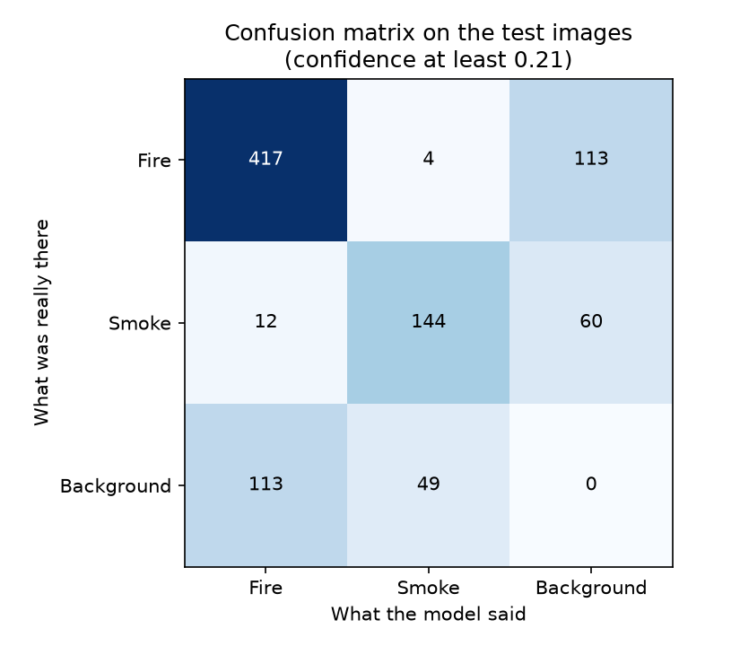
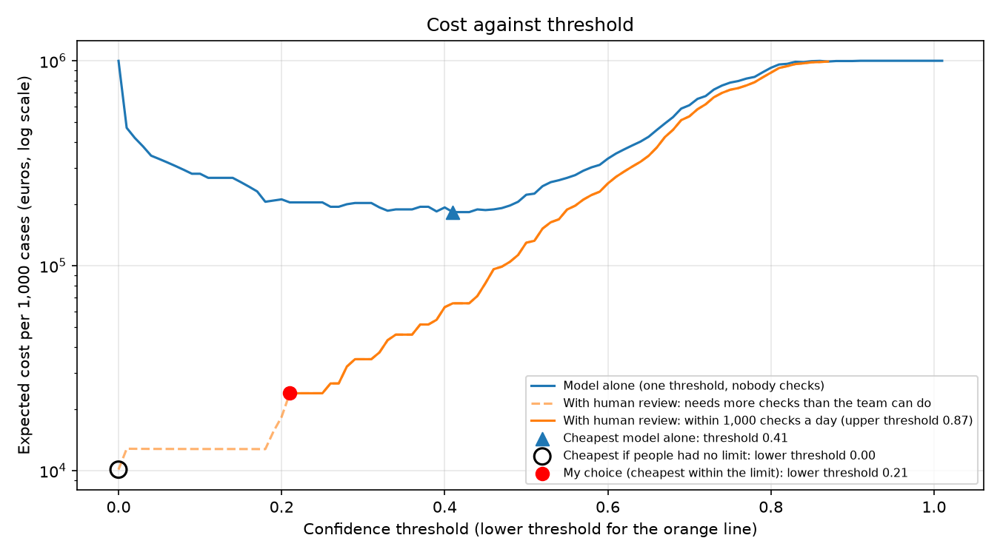

# Assignment 2 Report

*Delete this italic guidance as you fill in each section. You'll be asked to
defend any of this without your code in front of you. Write only what you
can actually explain.*

- **Name**: Juan C Chavarria
- **Student ID**: 19313
- **Email**: jchavarria.ieu2022@student.ie.edu
- **Group**: [BBADBA 5B]

## Business problem, and the cost of being wrong

This model helps decide whether a camera image shows fire, so that the firemen are called in time. It would run on cameras in public buildings, and the alerts go to an operator in the building's control room. The operator looks at the image and decides whether to call the firemen.

A missed fire is the worst mistake. If a fire is found late, I assume it destroys about a quarter of a 1,000 m² Madrid building and its contents. The building is worth about €2.75 million (€2,747 per m²) and the inside about €1.1 million (€1,124 per m²), so about €3.9 million in total, and a quarter of that is roughly €1,000,000. A false alarm costs much less. If the firemen are called for nothing I assume about €1,000, and if the operator only has to look at an image I assume about €0.20. So a missed fire is worth about 1,000 false callouts, which means the model should raise alerts easily and the operator filters out the false ones.

The model has three outcomes:

| Model confidence | What happens | Cost |
|---|---|---|
| Low | Pass, nothing happens | €0 if no fire, €1,000,000 if there was a fire (missed) |
| Middle | Sent to the operator to check | about €0.20 per check |
| High | Fail, the firemen are called straight away | €0 if real fire, €1,000 if false |

Where the numbers come from:
- Building price: about €2,747 per m² for offices in Madrid in the first quarter of 2026 (Brains, https://brainsre.news/?p=302756).
- Inside of the building: about €1,124 per m² to fit out an office in Madrid in 2026 (Cushman & Wakefield fit-out guide, reported at https://brainsre.news/madrid-barcelona-competitividad-oficinas-costes/).
- Late fire damage, about a quarter of the total: my own assumption, because buildings also have smoke detectors and sprinklers, so a miss means the fire is found late, not that nothing detects it.
- False callout, €1,000: my own assumption. About €500 for six firefighters and two trucks for an hour, using the fees of a Gipuzkoa city council (€41 an hour per firefighter, €28 to €185 per vehicle, https://www.ondavasca.com/las-tasas-por-imprudencias-de-donostia-listas-para-aplicarse/amp/), plus about €500 for the building being disturbed.
- Operator check, €0.20: my own assumption, 30 seconds of an operator paid about €20 an hour including costs.
- I also assume the operator always judges correctly, which makes the review step look better than it really is.

## Dataset

I used a public dataset from Roboflow Universe, without forking it.

- Workspace: sayed-gamall
- Project: fire-smoke-detection-yolov11
- Version: 2
- Link: https://universe.roboflow.com/sayed-gamall/fire-smoke-detection-yolov11

One image is one photo. The model finds objects in it and labels them as one of two classes: Fire or Smoke. I chose it because it has both classes, and because smoke can show a fire before the flames are visible, which fits my problem of finding fires early. The photos are mostly pictures from the web (close-ups of flames, forests, smoke clouds), not frames from a security camera, so it only partly matches what the cameras in a building would see.

## What the dataset's composition implies

| Split | Images | Fire objects | Smoke objects |
|---|---|---|---|
| Train | 9,156 | 11,505 | 4,312 |
| Valid | 872 | 1,137 | 400 |
| Test | 435 | 544 | 216 |

Roboflow made 3 altered copies (flipped, rotated, brighter or darker) of every training photo. So the 9,156 training images are about 3,052 real photos. The valid and test sets are not altered.

What this means:
- There is about 2.5 times more fire than smoke, so the model has fewer examples of smoke to learn from and will probably be weaker on it. The test set has only 216 smoke objects, so the smoke results will be noisy and I should not trust small differences.
- Fire is small in the photo (about 3% of the image in the test set) and smoke is big (about 16%). I expected more missed fires than missed smoke, because small objects are harder to find. The results showed the opposite: smoke is the weaker class (see the per-class section).
- Almost every image has fire or smoke in it. All 435 test images do, and only 4 of the 9,156 training images are empty. So this dataset cannot tell me how often the model raises a false alarm on a normal scene, such as an empty room. I will have to assume how often real fires happen in the cost section, and the false alarm numbers will only come from images that have smoke but no fire.
- The photos look like web photos, not security camera footage, so I cannot conclude how well the model would work on a real camera feed in a building.

## Finetuning and baselines

I used the object detection task, because the model has to find where the fire or smoke is in the photo, not only say that it is there. I used yolo11n, the smallest YOLO11 model, because it is fast and my dataset is not very large. I started from the pretrained COCO model (already trained on everyday objects) and finetuned it on my fire and smoke photos.

Training settings: Google Colab with a T4 GPU, up to 20 epochs, image size 640, batch size 16, seed 0, using all 9,156 training images. The best version on the validation images is saved in weights/best.pt.

All results are on the same 435 test images.

| Model | AP50 | mAP50-95 |
|---|---|---|
| My finetuned yolo11n | 0.752 | 0.441 |
| Pretrained COCO model, no finetuning | 0.000 | 0.000 |
| Predict nothing | 0.000 | 0.000 |

The two baselines score 0 because they cannot find fire or smoke at all. The COCO model only knows 80 everyday objects (it has "fire hydrant" but no fire or smoke), so it cannot name either class. The predict-nothing baseline never raises an alarm, so it finds nothing. I did not run the COCO model on the test images. I know it scores 0 because it has no matching class. The gap is huge because both baselines are very weak, so beating them does not show that the model is good enough to use. That question is answered in the cost section.

## Per-class evaluation and failure modes

Fire is the positive class, as in the cost section. All numbers are on the 435 test images.

| Class | Real objects | Precision | Recall | AP50 | mAP50-95 |
|---|---|---|---|---|---|
| Fire | 534 | 0.775 | 0.780 | 0.821 | 0.486 |
| Smoke | 216 | 0.749 | 0.636 | 0.682 | 0.396 |
| All | 750 | 0.762 | 0.708 | 0.752 | 0.441 |

Fire carries the headline number. Smoke drags it down, and its recall of 64% is the weakest figure in the table: the model misses about a third of the smoke.

Confusion matrix, using confidence of at least 0.21 (my lower threshold). An object counts as found if the model's box overlaps the real box by at least 50%. Rows are what was really there, columns are what the model said. "Nothing" in the last column means a real object the model missed, and "Nothing" in the last row means a box where there was nothing.

| Really there / Model said | Fire | Smoke | Nothing (missed) |
|---|---|---|---|
| Fire | 417 | 4 | 113 |
| Smoke | 12 | 144 | 60 |
| Nothing | 113 | 49 | – |

At this confidence the precision and recall are slightly different from the table above (fire 0.77 and 0.78, smoke 0.73 and 0.67), because the table above uses the confidence level that gives the best balance.

What the matrix shows:
- The model almost never mixes the two classes up. Only 4 fires were called smoke and only 12 smokes were called fire.
- Its mistakes are mostly misses (113 fires and 60 smokes) and boxes where nothing matches (113 as fire, 49 as smoke).
- These two numbers are not fully separate. If the model finds a fire but draws the box in the wrong place (overlap under 50%), it counts once as a miss and once as a false alarm. So some of the 113 and 113 are the same fires, and the real number of fires the model completely missed is lower.

Where it breaks: the size of the object in the image.

| Size of the object | Fire found | Smoke found |
|---|---|---|
| Under 1% of the image | 115 of 174 (66%) | 0 of 3 |
| 1% to 5% | 105 of 139 (76%) | 2 of 16 (12%) |
| 5% to 20% | 122 of 141 (87%) | 67 of 109 (61%) |
| Over 20% | 75 of 80 (94%) | 75 of 88 (85%) |

Both classes get worse as the object gets smaller. Fire goes from 94% found when it is large to 66% when it is tiny. Smoke goes from 85% to 12%, but there are only 19 smoke objects under 5% of the image, so those two numbers are very uncertain and I would not trust them.

Smoke is weaker than fire even at medium sizes (61% against 87% at 5% to 20%), so size is not the only reason. My guess is that smoke has fuzzy edges, so it is harder to draw a box that matches the real one, and the training set has fewer smoke examples (4,312 smoke objects against 11,505 fire objects, including the altered copies). I did not test this.

What this means for my problem: my costs only treat Fire as positive, so the weak smoke results do not change my cost numbers. But a small, distant fire is exactly what a camera is for, and that is where the model is weakest (66% found). Also, my cost calculation counts an image as caught if the model finds at least one fire box, which is easier than finding every fire, so it is kinder than this table.

## Cost matrix and operating point

I treat Fire as the positive class. One case is one image. An image counts as a real fire if the test labels have at least one Fire box in it, and the model's score for an image is the highest confidence of any Fire box it found (0 if it found none). My 356 test images with fire are the positives and my 79 test images with only smoke are the negatives. This is a simple way to count: it does not check that the box is in the right place, and finding one flame in an image is easier than finding every flame, which is why 98.6% of fire images get at least one alert here while the per-object recall is only 78%.

| Case | Cost |
|---|---|
| Real fire, passed (missed) | €1,000,000 |
| Real fire, sent to a person | €0.20 for the check + €10,000 extra damage from the delay |
| Real fire, firemen called directly | €0 |
| No fire, passed | €0 |
| No fire, sent to a person | €0.20 |
| No fire, firemen called directly (false callout) | €1,000 |

The €1,000,000, €1,000 and €0.20 come from my business section. The €10,000 delay is my own assumption: a fire that waits for a person to look at it grows a bit more than one that gets an immediate call.

I also assume 5,000 images arrive per day (for example about 50 cameras sending one image every 15 minutes), and that a person needs 30 seconds to check one image. So one operator can do about 1,000 checks in a working day, and I use that as the limit of what the team can do.

Base rate: I assume 1 in 1,000 images shows a real fire. I picked this myself, and it is high. With 5,000 images a day it means about 5 fire images a day, which is more than a real building would have. I checked what happens with other values. From 1 in 100,000 to 1 in 1,000 the chosen thresholds do not change at all, only the cost gets smaller (about €276 per 1,000 images at 1 in 100,000). Only if fires were as common as 1 in 100 would the best plan change, with the thresholds moving to 0.18 and 0.55 so that more images go straight to the firemen.

How I chose the thresholds: I tried every pair of thresholds from 0.00 to 1.00 in steps of 0.01 (the lower one never above the upper one), calculated the expected cost per 1,000 images for each pair, and took the cheapest pair that one operator can handle (at most 1,000 checks a day). The best pair is lower 0.21 and upper 0.87, with an expected cost of about €23,858 per 1,000 images.

The solid orange line is the part that one operator can handle (at most 1,000 checks a day). The dashed part, to the left of about 0.18, needs more checks than that. The cheapest point on the whole orange line is at 0.00 (the hollow circle), where everything goes to a person. My choice, the red dot at 0.21, is the cheapest point I can actually staff. The blue triangle is the cheapest the model can do on its own, at a threshold of about 0.41.

At these thresholds, the 356 test images with fire split into 5 passed (1.4%), 348 sent to a person (97.8%) and 3 called directly (0.8%). The 79 images without fire split into 64 passed (81%), 15 sent to a person (19%) and 0 called directly. Almost all the cost comes from fires: about €14,000 from the missed ones, about €9,800 from the delay on the ones sent to a person, and only about €40 from everything else. Only 5 missed fires is a small number, so the miss rate of 1.4% is not precise.

The assumption that would most change my answer is how many images a person can check per day. The lower threshold of 0.21 exists only because I allowed 1,000 checks a day. Here is what happens if the team can do more or fewer checks (everything else the same):

| Checks per day | Lower threshold | Upper threshold | Cost per 1,000 images | Share sent to a person |
|---|---|---|---|---|
| 0 | 0.41 | 0.41 | €182,635 | 0% |
| 250 | 0.41 | 0.55 | €145,942 | 3.8% |
| 1,000 (my assumption) | 0.21 | 0.87 | €23,858 | 19.1% |
| 2,500 | 0.18 | 0.87 | €12,737 | 20.3% |

With no checks the model decides alone and the cost is 7 times higher. Going from 250 to 1,000 checks a day cuts the cost by more than 80%, so the people matter as much as the model. If people could check everything, the cheapest plan would send all images to a person (lower threshold 0.00), costing €10,116 per 1,000 images and needing 5.2 operators.

The cost of a missed fire matters less. If it were only €50,000 the thresholds would stay the same (0.21 and 0.87), and if it were €4,000,000 they would only move a little (0.18 and 0.84).

Caution: I chose the thresholds on the same 435 test images I used to report the cost, so the cost is probably a bit better than I would get on new images. The no-fire group has only 79 images, so the false alarm rate is based on little data, and these images contain smoke, which is probably harder than an empty room.

## What a person still has to check

My two thresholds are 0.21 and 0.87. Below 0.21 the image is passed, between 0.21 and 0.87 it goes to the operator, and from 0.87 up the firemen are called directly.

19.1% of cases go to a person. With 5,000 images a day that is about 953 images a day. At 30 seconds each that is 7.9 hours of checking a day, which is one operator working a full day. This fits, but with no spare time. Also, a building needs someone watching 24 hours a day, so in practice I would need at least 3 people working in shifts, and they would be idle most of the time.

I priced my design against three alternatives, per 1,000 images:

| Plan | Cost per 1,000 images | People needed |
|---|---|---|
| Do nothing | €1,000,000 | 0 |
| A person checks everything | €10,200 | about 5 operators (41.7 hours a day) |
| The model decides alone (one threshold, 0.41) | €182,635 | 0, but every alert calls the firemen |
| The model plus a person (my design) | €23,858 | 1 operator (7.9 hours a day) |

Doing nothing is by far the worst. The model alone is bad because every false alert costs €1,000. Checking everything is the cheapest in euros, but it needs about 5 operators looking at 5,000 images a day. My design costs more per 1,000 images but needs only one operator's time. So under my assumptions the model's value is a smaller workload, not a lower cost. It may also be more reliable, because a person looking at 5,000 images a day will get tired and miss things, while my assumption that the operator is always right ignores that.

## Limitations & next steps
These are the real limits I found, and what I would do about each one.

1. **The test images are not what a real camera sees.** The dataset is mostly web photos (close-ups of flames, forests, smoke clouds), and every test image has fire or smoke in it. I never tested the model on a normal scene like an empty room, a kitchen with steam or a bright lamp, so my false alarm numbers only come from 79 images with smoke and no fire. With more time I would collect frames from real building cameras, including lots of normal ones, and test on those.

2. **I chose the thresholds on the same images I used to report the cost.** This makes my cost of about €23,858 per 1,000 images a bit too good. I would choose the thresholds on the validation images and report the cost only on the test images.

3. **Smoke and small fires are the weak spots.** Smoke is found 64% of the time against 78% for fire, and fire smaller than 1% of the image is found only 66% of the time. A small, far-away fire is exactly what a camera is for. I would add more smoke examples, try the bigger yolo11s model and a larger image size, and split big images into tiles so small objects look bigger.

4. **The costs are my own assumptions.** The €1,000,000 for a missed fire, the €1,000 for a false callout, the €10,000 delay, the 1-in-1,000 base rate and 30 seconds per check are guesses with reasons, not real data. The most important is the number of checks a team can do per day, which changes the cost from €182,635 to €12,737 per 1,000 images. I would ask a fire brigade and an insurer for real figures, and measure how long a check really takes.

5. **I assume the operator is always right.** A real person checking 1,000 images a day will get tired and miss things, and a building needs someone watching 24 hours, so one operator is not enough. I would measure the operator's mistakes and add them to the cost calculation.

6. **My cost calculation counts an image as caught if the model finds at least one fire box.** It does not check that the box is in the right place, so it is kinder than the object results. I would count an image as caught only if the box matches a real fire.

7. **I did one training run.** I did not repeat it with different seeds, so I do not know how much the numbers move from run to run, and with only 216 smoke objects in the test set I expect small differences to be noise. I also did not run the pretrained COCO model on the test images: I know it scores 0 because it has no fire or smoke class, but I did not measure it. I would repeat the run with several seeds and report a range.

8. **The dataset has some repeated labels and a few labels drawn as outlines instead of boxes.** I counted outlines as boxes, which is a small simplification.

## Generative AI use disclosure

I used Claude (an AI assistant made by Anthropic) for this assignment.

What it did: it helped me find datasets on Roboflow Universe, wrote the code in train.py, explore_data.py, costing.py, evaluation.py and app.py (the dataset download, the training call, the threshold sweep, the plots and the dashboard), explained how to set up Colab, Git and VS Code, and looked up sources for the Madrid office prices and firefighter costs. It also suggested starting values for some of my cost assumptions (the €10,000 delay, 5,000 images a day, 30 seconds per check and 1,000 checks a day) and wrote a first draft of the text in REPORT.md.

[I went through each assumption and kept or changed it myself. I rewrote the analysis, explanations and conclusions in REPORT.md in my own words, and the decisions in it are mine: the problem, which class is positive, the cost figures, where the thresholds go, how much goes to a person, and whether the model is good enough to ship.]